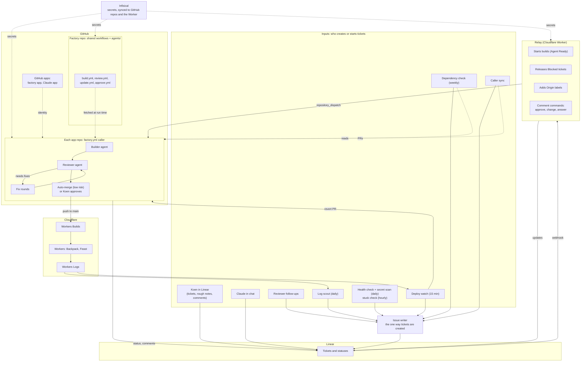
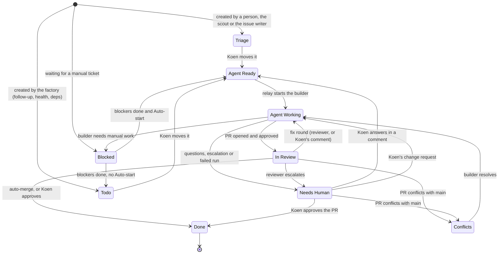

# Architecture

How the factory fits together, in two pictures. Keep them up to date: when a change adds or removes a part shown here, update the diagrams in the same PR (a rule in `CLAUDE.md`, checked by the reviewer).

## 1. The big picture

**Inputs.** Tickets come from Koen (a ticket or a rough note in Triage, which the issue writer rewrites), from Claude in chat, and from the factory itself: the reviewer's follow-ups, the log scout ([README](../README.md#log-scout)), the daily health check and secret scan ([health check](health-check.md), [secret scan](secret-scan.md)), deploy watching ([deploy watch](deploy-watch.md)), the weekly dependency check ([dependency updates](dependency-updates.md)) and the caller sync (README, "How caller changes reach the app repos"). Everything the factory creates goes through the issue writer ([issue writer](issue-writer.md)), which sets labels, status and dedup. Agent-made tickets never start Agent Ready on their own except where the dependency check says so.

**The relay** is a Cloudflare Worker that Linear calls with a webhook (`relay/`). It starts a build in the right app repo when a ticket moves to Agent Ready, releases Blocked tickets when their blockers are done, gives new tickets an Origin label (and sends rough notes to the issue writer), and handles Linear comment commands: `approve`, change requests and answers to the builder's questions ([Linear commands](linear-commands.md)).

**The agents** run in GitHub Actions in each app repo. The app's small `factory.yml` caller uses the factory's shared workflows, and the scripts and prompts in `agents/` are fetched from `main` at run time. The builder opens a PR; the reviewer approves, asks for fixes (max 2 automatic rounds, and every round starts by merging the base branch, see [merge conflicts](merge-conflicts.md)) or escalates to Koen. A low-risk approval turns on auto-merge; otherwise Koen approves, also from a Linear comment. Decisions are described in the README's "How decisions are made", previews in [previews](previews.md), usage limits in [usage limits](usage-limits.md).

**Outside services.** GitHub holds the repos and runs the agents, using the factory app (acts as the factory) and the Claude app. Cloudflare runs the apps as Workers, builds them with Workers Builds when `main` changes, and keeps their Workers Logs, which the scout and deploy watch read. Linear is where Koen works. Infisical is the one place for secrets: `/shared` goes to the factory and app repos, `/cloudflare/factory-relay` to the relay Worker, and `/github/factory` to the repos that need those extra tokens (README, "Secrets").

**The apps** (Backpack, Feast) are merged to `main` and deployed by Cloudflare Workers Builds; an hour later deploy watching compares production with the day before and opens a revert PR (never auto-merged) if it got worse.

## 2. A ticket's life

**Where Koen is needed:** moving Triage and Todo tickets to Agent Ready, answering questions in **Needs Human**, approving or changing escalated PRs (any workflow, security, schema or large change always escalates), and the manual tickets (**Blocked** tickets wait for him). Everything else, including low-risk merges, runs without him.

**What moves a ticket:** the relay (Agent Ready, Blocked releases, answers), the builder and reviewer scripts (Agent Working, In Review, Needs Human, Conflicts) and Linear's GitHub integration (Done when the PR is merged). The hourly stuck check retries a run that died and hands anything stuck twice to Needs Human. See the README's "How decisions are made" and [health check](health-check.md#stuck-tickets-and-prs-hourly).
